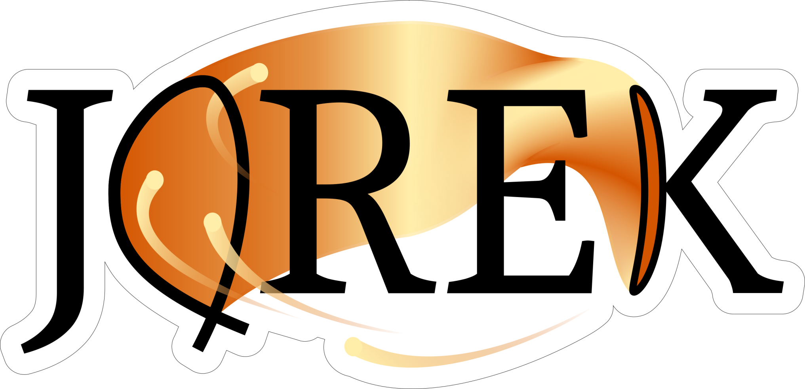

# The JOREK logo

The main logo (the logo that should in general be used) is available in three different high-resolution file formats as listed below. Please note that only the png logo does not include a background. 

## PNG

[JOREK logo png](assets/jorek_logo/JOREK_logo.png)
## JPG

[JOREK logo jpg](assets/jorek_logo/JOREK_logo.jpg)
## PDF

[JOREK logo pdf](assets/jorek_logo/JOREK_logo.pdf)

## Dark mode

On dark backgrounds, the black text of the logo might not be properly visible. In this case there a number of different solutions. Some possibilities for logo's are given below. 

